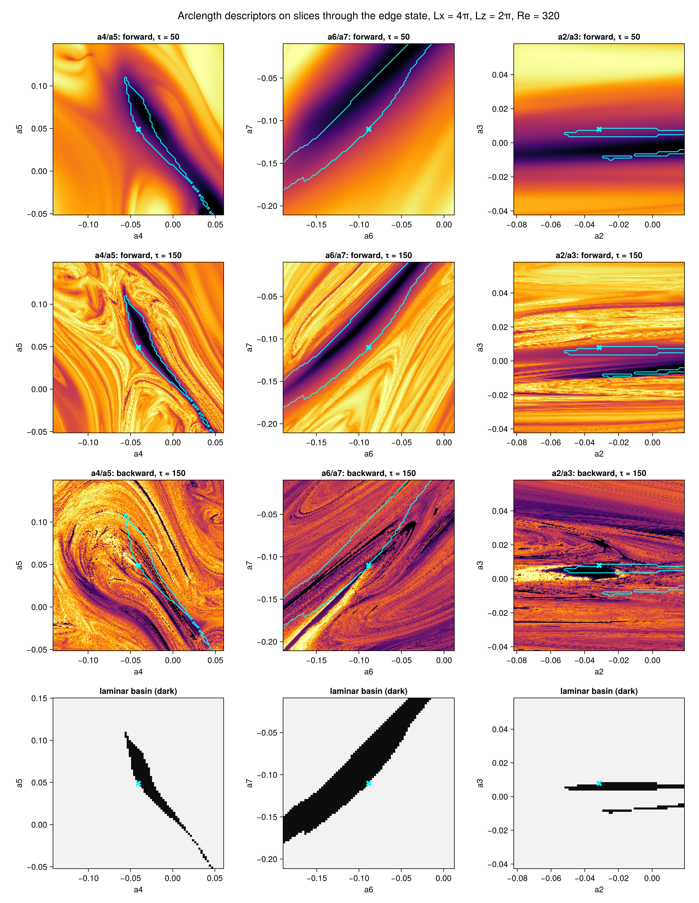

# MFE shear flow: bifurcations and Lagrangian descriptors

[](https://rmsrosa.github.io/MFEShearFlowLagrangianDescriptors/dev/)
[](https://github.com/rmsrosa/MFEShearFlowLagrangianDescriptors/actions/workflows/CI.yml)
[](https://opensource.org/licenses/MIT)


A documentation-style repository (scripts and Documenter pages, **not** a Julia package)
that uses the nine-mode Galerkin model of Moehlis, Faisst and Eckhardt (MFE) for sinusoidal
shear flow as a worked example for
[LagrangianDescriptors.jl](https://juliadynamics.github.io/LagrangianDescriptors.jl/dev),
with a bifurcation analysis from
[BifurcationKit.jl](https://bifurcationkit.github.io/BifurcationKitDocs.jl/stable/).



## The model

Incompressible Navier–Stokes flow between free-slip walls at `y = ±1`, periodic in the
streamwise `x` (length `Lx`) and spanwise `z` (length `Lz`) directions, driven by the
body force `√2 π²/(4Re) sin(πy/2) ê_x`, whose laminar response is `√2 sin(πy/2) ê_x`. The
velocity is expanded in nine orthonormal, divergence-free basis fields (basic profile,
streak, downstream vortex, spanwise flows, normal vortex modes, a three-dimensional mode,
and a modification of the basic profile), giving nine quadratic ODEs

    daᵢ/dt = -(λᵢ/Re) aᵢ + (β²/Re) δᵢ₁ + Σⱼₖ Nᵢⱼₖ aⱼ aₖ,

with `α = 2π/Lx`, `β = π/2`, `γ = 2π/Lz`. The laminar state is `a = (1, 0, …, 0)`, linearly
stable for all `Re`; turbulence is a transient chaotic saddle, with exponentially
distributed lifetimes.

- J. Moehlis, H. Faisst, B. Eckhardt, *New J. Phys.* **6**, 56 (2004): model and transient turbulence.
- J. Moehlis, H. Faisst, B. Eckhardt, *SIAM J. Appl. Dyn. Syst.* **4**, 352 (2005): fixed points, periodic orbits, attractors.

## Layout

| path | contents |
|:---- |:-------- |
| `src/mfe.jl` | `MFEParams`, the in-place right-hand side `mfe!(da, a, p, t)` (explicit NJP eqs 21–32; allocation-free, type-stable), energies |
| `src/galerkin.jl` | the nine basis fields and an independent Galerkin projection (`GalerkinMFE`, `galerkin_mfe!`) |
| `src/tools.jl` | lifetimes, Poincaré sections, largest Lyapunov exponent, Newton for equilibria, edge bisection/tracking |
| `src/setup.jl` | included by the scripts: loads the above and caches expensive results |
| `scripts/` | Literate scripts, one per topic (below) |
| `docs/` | Documenter setup; `docs/src/assets` holds the figures and the cached data (`data/*.csv`) |
| `test/` | `Test`-based checks (`runtests.jl`) |
| `Project.toml`, `Manifest.toml` | reproducible environment (Julia 1.13) |

These files are plain includes, not a module: `include("src/setup.jl")` gives you everything.

## Setup

```sh
julia --project=. -e 'using Pkg; Pkg.instantiate()'
```

LagrangianDescriptors.jl is not registered; the `[sources]` section of `Project.toml`
points Pkg to its GitHub repository, and the Manifest pins the commit. LagrangianDescriptors
v0.3.0 and BifurcationKit v0.9.0 install together without compat conflicts on Julia 1.13.

## Running the scripts

Run from the repository root; `-t 4` (or `-t auto`) parallelises the ensembles.

| script | what | time with cache / from scratch (4 threads) |
|:------ |:---- |:------------------- |
| `scripts/01_model.jl` | equations, the two implementations and their agreement, laminar stability | ~30 s |
| `scripts/02_timeseries_lifetimes.jl` | chaotic transients, lifetime maps (NJP Figs 6, 8), survival probabilities (Figs 7, 10) | ~30 s / ~1 min |
| `scripts/03_bifurcations.jl` | BifurcationKit continuation of equilibria and periodic orbits vs SIADS, minimal-flow-unit attractors and Lyapunov exponents, edge tracking | ~1 min / ~6 min |
| `scripts/04_lagrangian_descriptors.jl` | descriptor maps on 2D slices through edge states and equilibria, with the laminar basin boundary | ~30 s / ~10 min |

```sh
julia --project=. -t 4 scripts/03_bifurcations.jl
```

Expensive results are cached as CSV files in `docs/src/assets/data` and reused. To
recompute everything from scratch, set `MFE_RECOMPUTE=true` (or delete the files):

```sh
MFE_RECOMPUTE=true julia --project=. -t 4 scripts/04_lagrangian_descriptors.jl
```

Each script also rewrites its figures in `docs/src/assets`, so the committed figures are
reproducible from the scripts.

## Tests

```sh
julia --project=. test/runtests.jl                    # all checks, ~2 min
MFE_FAST_TESTS=1 julia --project=. test/runtests.jl   # model checks only, ~1 min
```

They check the basis fields, the agreement of the explicit and projected equations, the
laminar fixed point, energy conservation, linear stability and allocations; and,
qualitatively, the subcritical transition, the stable periodic orbit (T ≈ 112.5) and chaotic
attractor of the minimal flow unit, exponential lifetimes, edge tracking, and the
saddle-node and Hopf points of SIADS 2005. See `docs/src/validation.md`.

## Building the docs

```sh
julia --project=. -t 4 docs/make.jl
```

Literate runs each script (with the cache this takes about two minutes) and Documenter
writes the site to `docs/build` (open `docs/build/index.html`). On every push to `main`,
the `docs` job of `.github/workflows/CI.yml` builds the site and deploys it to the `gh-pages`
branch, published at https://rmsrosa.github.io/MFEShearFlowLagrangianDescriptors/dev/.

## Main results

| | SIADS 2005 | here |
|:-- |:-- |:-- |
| `Lx = 4π, Lz = 2π`: saddle-node / Hopf of equilibria | 308.16 / 310.34 | 308.16 / 310.34 |
| fold of the Hopf periodic orbits | 186.99, T = 46.80 | 186.99, T = 46.80 |
| `Lx = 1.75π, Lz = 1.2π`: saddle-node / Hopf | 794.51 / 795.12 | 794.51 / 795.12 |
| fold of the Hopf periodic orbits | 452.99, T = 51.35 | 452.99, T = 51.35 |
| stable periodic orbit at Re = 400 (minimal flow unit) | T = 112.51 | T = 112.50 |

The edge state (found by edge tracking) lies close to the laminar state and is not one of
the saddle-node equilibria. On slices through it, forward Lagrangian descriptors
outline the laminar basin and its boundary, the stable manifold of the edge state, as
confirmed by a direct classification of the same grid.

## License

MIT; see [LICENSE](LICENSE).
