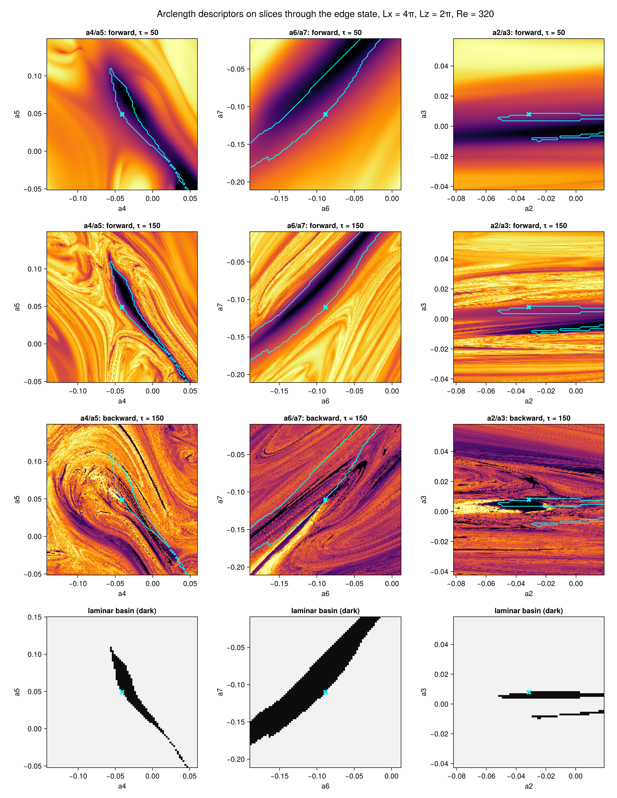

# MFE shear flow: bifurcations and Lagrangian descriptors

This site uses the nine-mode Galerkin model of Moehlis, Faisst and Eckhardt (MFE) for
sinusoidal shear flow between free-slip walls as a worked example for
[LagrangianDescriptors.jl](https://juliadynamics.github.io/LagrangianDescriptors.jl/dev),
together with a bifurcation analysis with
[BifurcationKit.jl](https://bifurcationkit.github.io/BifurcationKitDocs.jl/stable/).

## Pages

- [Model](generated/01_model.md): the equations, two independent implementations (explicit
  transcription and Galerkin projection) and their agreement, laminar stability.
- [Validation](validation.md): what the test suite checks against the papers.
- [Time series and lifetimes](generated/02_timeseries_lifetimes.md): chaotic transients,
  lifetime maps and exponential lifetime distributions (NJP 2004).
- [Bifurcations and edge state](generated/03_bifurcations.md): continuation of equilibria and
  periodic orbits with BifurcationKit, compared with SIADS 2005; attractors of the minimal
  flow unit and their Lyapunov exponents; edge tracking.
- [Lagrangian descriptors](generated/04_lagrangian_descriptors.md): descriptor maps on
  slices of the nine-dimensional phase space, compared with the laminar basin boundary.

## References

- J. Moehlis, H. Faisst, B. Eckhardt, *A low-dimensional model for turbulent shear flows*,
  New J. Phys. **6**, 56 (2004). (NJP)
- J. Moehlis, H. Faisst, B. Eckhardt, *Periodic orbits and chaotic sets in a
  low-dimensional model for shear flows*, SIAM J. Appl. Dyn. Syst. **4**, 352 (2005). (SIADS)
- J. D. Skufca, J. A. Yorke, B. Eckhardt, *Edge of chaos in a parallel shear flow*,
  Phys. Rev. Lett. **96**, 174101 (2006). Note: their nine-variable model is a related but
  different reduction (from A. Schmiegel's thesis), so we use their method, not their numbers.
- A. M. Mancho, S. Wiggins, J. Curbelo, C. Mendoza, *Lagrangian descriptors: A method for
  revealing phase space structures of general time dependent dynamical systems*,
  Commun. Nonlinear Sci. Numer. Simul. **18**, 3530 (2013).
