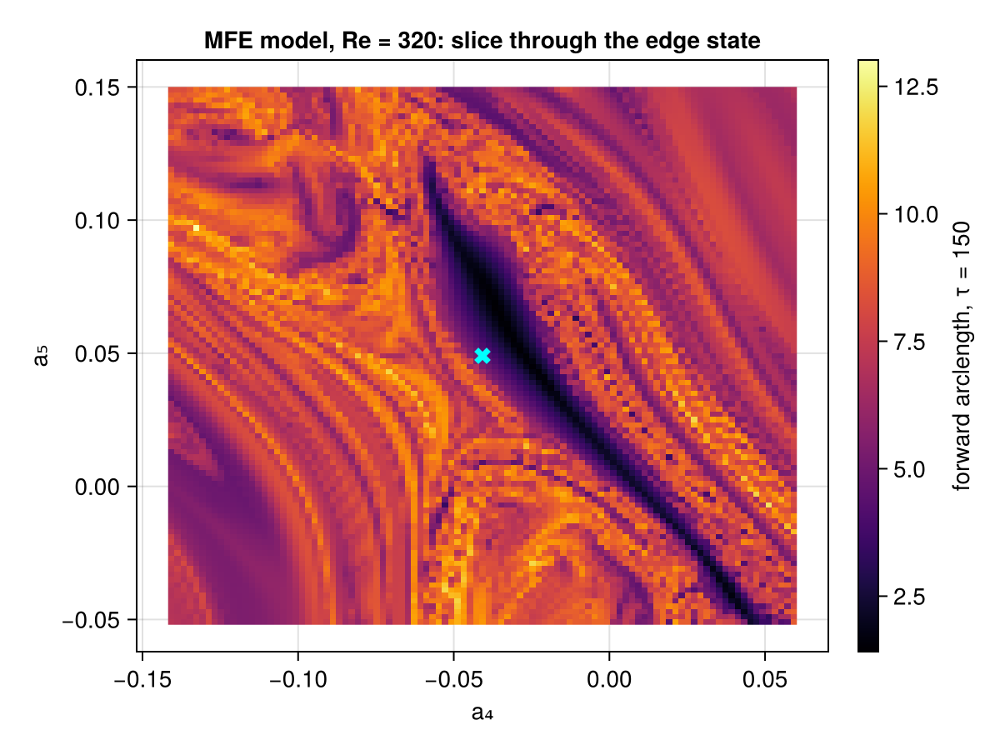

# Proposal: an MFE shear-flow example page for LagrangianDescriptors.jl

A trimmed version of `scripts/04_lagrangian_descriptors.jl` for the LagrangianDescriptors.jl
documentation (`docs/src/examples/`), alongside the Lorenz and double-gyre examples. Not
submitted anywhere yet; this is a draft for review.

## Why it fits

- A **nine-dimensional** dissipative system shown through **two-dimensional slices**, which
  exercises the slice plotting (`idxs = (4, 5)`) on a higher-dimensional problem than the
  current examples (at most four dimensions, in the double pendulum).
- It shows a structure people care about: the **laminar–turbulent boundary** (edge of chaos)
  of a shear flow, as the dark band of the forward descriptor, with the edge state on it.
- It needs `max_trajectory_value`, since backward solutions of the dissipative model blow up.

## Constraints for the docs build

- **No dependency on this repository.** The right-hand side (25 lines) is inlined, and the
  edge state is given as nine numbers. `proposals/mfe_example.jl` is the self-contained
  draft; its `mfe!` agrees with `src/mfe.jl` to `2e-15`.
- **Cheap.** One slice on a `101 × 101` grid, forward only, `τ = 150`: about 5 s of solving
  with 4 threads (about 30 s with compilation). Only the packages the docs already use
  (OrdinaryDiffEq, CairoMakie).
- Optionally, a pre-rendered figure of the full analysis (`docs/src/assets/ld_edge_re320.png`
  of this repository: three slices, forward and backward, basin boundary overlaid), shown as
  a static image, with a link here for how it was made.

## Draft page outline

1. **The model** (one paragraph): nine-mode Galerkin model of sinusoidal shear flow
   (Moehlis, Faisst & Eckhardt, NJP 2004), laminar state `a = (1, 0, …, 0)` linearly stable,
   turbulence transient; `Lx = 4π`, `Lz = 2π`, `Re = 320`. The equations as a `@example` block
   (the inlined `mfe!`).
2. **The slice**: through the edge state found by edge tracking (computed in this
   repository; given as numbers), varying the spanwise-flow amplitudes `a₄`, `a₅`.
3. **Solve and plot**, as in `proposals/mfe_example.jl`:
   ```julia
   prob = ODEProblem(mfe!, edge, (0.0, 150.0), p)
   uu0 = [(u = copy(edge); u[4] = x; u[5] = y; u) for y in a5s, x in a4s]
   lagsol = solve(LagrangianDescriptorProblem(prob, M, uu0; direction = :forward), Tsit5();
                  max_trajectory_value = 5.0)
   heatmap(lagsol, :forward; idxs = (4, 5))
   ```
4. **Reading the picture** (a few sentences): the dark band is the set of initial conditions
   that decay quickly to the laminar state (short arclength); its sides are the laminar basin
   boundary, the stable manifold of the edge state, and the edge state lies on it; outside,
   the filaments are the stable manifolds of the chaotic saddle. In the full analysis the band
   matches an independent classification of the same grid (decays vs turbulent excursion).
5. **Link** to this repository for the model checks, the bifurcation analysis with
   BifurcationKit, other slices, `Re` values and descriptors.



## Open points

- This repository is local only; the link in step 5 needs a public URL first.
- The LagrangianDescriptors.jl docs use `@example` blocks executed at build time; the draft
  follows that. If build time matters more, step 3 can be shown as non-executed code with
  the pre-rendered figure instead.
